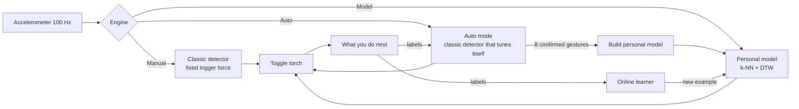
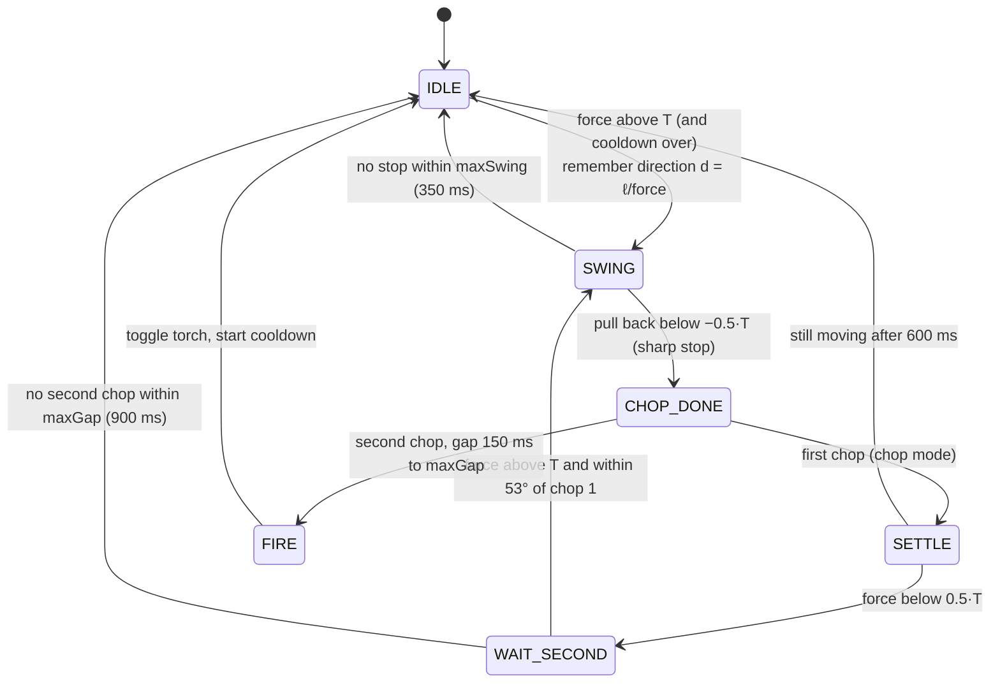
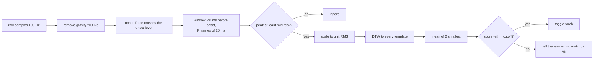
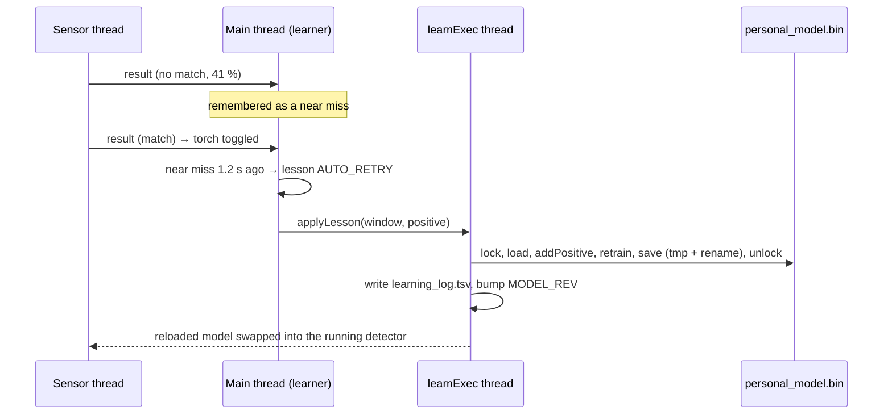

# How Chop Torch learns your gesture

This document explains every part of Chop Torch that recognises or learns your gesture: the rule-based detector, the personal model, the on-device ("edge") learning, and Auto mode. It is written for two readers at once:

- **Anyone curious.** Each part starts with an **In plain words** paragraph.
- **A computer science student.** Each part then gives **The exact rules**: formulas, constants, data structures, file formats and the source file that implements it. With this document and the code you should be able to re-implement the whole system.

All numbers in [section 11](#11-a-worked-example-with-real-numbers) come from running the app's own code on synthetic (computer-generated) motion on a desktop JVM. They are not measurements from a real phone.

Version: Chop Torch 4.2. Code: `app/src/main/java/dev/incog/choptorch/`.

---

## Contents

1. [The short version](#1-the-short-version)
2. [What the phone actually measures](#2-what-the-phone-actually-measures)
3. [The three engines](#3-the-three-engines)
4. [Engine 1: the classic detector (rules, no learning)](#4-engine-1-the-classic-detector-rules-no-learning)
5. [Calibrating the classic detector (grid search)](#5-calibrating-the-classic-detector-grid-search)
6. [Engine 2: the personal model (k-nearest neighbours with DTW)](#6-engine-2-the-personal-model-k-nearest-neighbours-with-dtw)
7. [Training the personal model](#7-training-the-personal-model)
8. [Edge learning: learning from everyday use](#8-edge-learning-learning-from-everyday-use)
9. [Engine 3: Auto mode](#9-engine-3-auto-mode)
10. [Threads, storage and file formats](#10-threads-storage-and-file-formats)
11. [A worked example with real numbers](#11-a-worked-example-with-real-numbers)
12. [Speed and memory](#12-speed-and-memory)
13. [Known limitations](#13-known-limitations)
14. [Glossary](#14-glossary)
15. [Code map](#15-code-map)
16. [References](#16-references)

---

## 1. The short version

- The phone's **accelerometer** reports how the phone is being pushed, 100 times a second.
- A **classic detector** uses fixed rules ("a hard swing, then a sharp stop, twice") with one number you can tune: the **trigger force**.
- **Auto mode** watches which gestures you really meant (from what you do next) and sets the trigger force to 70 % of your usual force. It also saves short recordings of your confirmed gestures.
- Once it has 8 good recordings, it trains a **personal model**. The model keeps your recordings as examples. A new movement counts as your gesture when its *shape* is close enough to your two most similar examples. Closeness is measured with **dynamic time warping (DTW)**, which allows a gesture to be a bit faster or slower.
- The model keeps **learning on the phone** from what you do next: repeating a gesture it missed, switching the torch back after a false trigger, tapping *Wasn't me*. Each lesson adds one example and recomputes the cutoffs in a few milliseconds.
- Nothing leaves the phone. The app has no internet permission.



---

## 2. What the phone actually measures

### In plain words

The accelerometer measures the force on the phone along three axes (x across the screen, y up the screen, z out of the screen), in metres per second squared (m/s²). Even lying still, it reads about 9.81 m/s² pointing up, because gravity pulls on it. To see *your* movement, the app must first subtract gravity.

### The exact rules

Each sample is a vector **a** = (aₓ, a_y, a_z) with a timestamp in nanoseconds. The service asks for one sample every 10 ms (`SAMPLE_US = 10_000` in `ChopService.kt`).

**Gravity removal** uses an exponential low-pass filter. For each new sample, with Δt the time since the previous sample (clamped to 0..0.2 s):

```
k = 1 − exp(−Δt / τ)
g ← g + k · (a − g)          (g is the gravity estimate)
ℓ = a − g                     (linear acceleration: your movement)
|ℓ| = sqrt(ℓx² + ℓy² + ℓz²)   (force, shown as "Live force")
```

τ (tau) is the filter's time constant. Movements much faster than τ pass through into ℓ; slow changes (turning the phone over) are absorbed into g. Different parts of the app use different τ values for different jobs:

| Where | τ | Why |
|---|---|---|
| Classic detector (`ChopDetector`) | 0.25 s | Follows rotation quickly. **Frozen during a swing**, so the swing itself is not absorbed into gravity. |
| Model front end (`Frontend`) | 0.6 s | Always updating, so the same gesture always gives the same signal for training and for live use. |
| Calibration gesture counter (`BurstSegmenter`) | 0.2 s | Only needs to tell "moving" from "still". |

The filter starts from the first sample (g = a). Whenever the sensor is paused and restarted (for example screen unlocked with *Only when locked*), every engine calls `restart()` and measures gravity again, because the phone may now be held differently.

A chop looks like this in |ℓ| (made-up but typical values):

```
force
(m/s²)
 30 |        _                 _
 20 |   ___ / \           ___ / \
 10 |  /   \   \         /   \   \
  0 |_/     \___\_______/     \___\________
     swing  stop  pause  swing  stop
     |<---- about 0.3–0.4 s ---->|
```

---

## 3. The three engines

The **Gesture** tab chooses one engine (`Engine` in `GestureEngine.kt`). All three implement the same interface:

```kotlin
interface GestureEngine {
    fun onSample(ax: Float, ay: Float, az: Float, tsNs: Long)
    var cooldownMs: Long        // "Delay between toggles", 300–2000 ms, default 1200
    fun takePeak(): Float       // for the Live force readout
    fun restart()               // forget half-seen gestures, re-measure gravity
}
```

| Engine | Learns? | What it learns | Main code |
|---|---|---|---|
| **Manual** (`CLASSIC`) | Only when you calibrate | One trigger force and timing variant | `ChopDetector.kt`, `calib/Calibrator.kt` |
| **Auto** (`AUTO`, default) | Yes, continuously | Your usual force, then a whole personal model | `ml/AutoPilot.kt`, `ml/Snippets.kt` |
| **Model** (`MODEL`) | Yes, continuously | New examples of your gesture and of what to ignore | `ml/PersonalModel.kt`, `ml/OnlineLearner.kt` |

---

## 4. Engine 1: the classic detector (rules, no learning)

### In plain words

A chop is a hard swing followed by a sharp stop in the opposite direction. The detector waits for two chops in the same direction, a short time apart. Only one number really matters: how hard the swing must be (the **trigger force**, default 14 m/s², about 1.4 g).

### The exact rules

`ChopDetector` is a **finite state machine**. T is the trigger force.



Details:

- **Same direction.** The second swing must point the same way as the first: the cosine of the angle between them must be above 0.6 (within about 53°). Spikes in the opposite direction are the arm coming back up and are ignored.
- **Gap** is measured from the start of chop 1 to the start of chop 2. Under 150 ms, the second chop becomes a new first chop (`GAP_OUT`).
- **Chop mode vs shake mode.** In chop mode (`requireSettle = true`, the default) the phone must calm below 0.5·T between the chops. Shake mode skips that.
- **Cooldown.** After a toggle, nothing starts for `cooldownMs`.
- **Swing peak.** While swinging, it tracks the largest projection ℓ·d. This number is the gesture's "force" used by Auto mode.

| Constant | Value |
|---|---|
| `DEFAULT_THRESHOLD` | 14 m/s² |
| `BRAKE_RATIO` | 0.5 (stop must reach 50 % of T, opposite way) |
| `SETTLE_RATIO` | 0.5 |
| `SAME_DIR_COS` | 0.6 |
| `MAX_SETTLE_MS` | 600 |
| `MIN_GAP_MS` | 150 |
| `DEFAULT_MAX_GAP_MS` / `DEFAULT_MAX_SWING_MS` | 900 / 350 |

Every decision emits an event (`chop 1`, `swing without a sharp stop`, ...) which is what the gesture log shows.

---

## 5. Calibrating the classic detector (grid search)

### In plain words

You do the gesture 8 times on cue. The app replays that recording through the real detector with hundreds of different settings and keeps the ones that recognise the most gestures without extra triggers. Then it sets the trigger a comfortable margin below your average strength.

### The exact rules (`calib/Calibrator.kt`)

1. **Find the gestures.** `BurstSegmenter` opens a burst when |ℓ| > 6 m/s² and closes it after 1.1 s below 3 m/s² (long enough to keep both chops of a slow double chop in one burst). Bursts under 30 ms are dropped.
2. **Peak** of each burst = largest |ℓ| from 150 ms before to 250 ms after it. A burst weaker than 50 % of the median peak is **ignored** (probably not a real attempt).
3. **Grid search.** 8 timing variants (chop/shake mode × max gap 900/1200 ms × max swing 350/500 ms) × 181 trigger forces (5 to 50 m/s² in steps of 0.25) = **1,448 full replays** of the recording.
   Each replay is scored as

   ```
   score = hits − 2 · extras
   ```

   A *hit* is a gesture with a trigger inside its window (150 ms before to 250 ms after). An *extra* is any other trigger. Extras cost double because a torch that switches on by itself is worse than one that needs a second try.
4. The **strictest** timing variant that reaches the best score wins (variants are listed strictest first). Within it, the **working range** [lo, hi] is the run of trigger forces with the best score.
5. **Strength** of each gesture = the highest trigger force at which it is still recognised. Average strength × level factor gives the trigger:

   | Level | Factor |
   |---|---|
   | Light | 0.60 |
   | Balanced (default) | 0.75 |
   | Firm | 0.90 |

   The result is clamped to [lo, hi] and snapped to 0.5.
6. **Accept** only if at least 3 gestures and at least 60 % of them are recognised.
7. **Running check.** It replays 30 s of synthetic running (2.8 steps/s, 11 and 16 m/s² bounce) and warns if the Light level would trigger.

In machine learning terms this is **hyper-parameter tuning by exhaustive grid search** with a hand-made objective. Nothing is "learned" beyond picking parameters.

---

## 6. Engine 2: the personal model (k-nearest neighbours with DTW)

### In plain words

The classic detector only knows "double chop". The personal model knows **your** gesture, whatever it is: a double chop, a twist, a flick. It keeps a small library of your own recordings ("this is my gesture") and recordings of normal handling ("this is not"). When the phone moves, it compares the new movement with your recordings. If it looks like your two most similar recordings, the torch switches.

To compare movements it ignores how hard you moved (only the shape counts) and lets one movement be stretched or squeezed in time to line up with the other. That stretching is called dynamic time warping.

### Why this kind of model?

| Requirement | Consequence |
|---|---|
| Only 3–8 examples of the gesture at first | Too few to train a neural network; nearest-neighbour methods work with a handful of examples. |
| Must learn new examples instantly on the phone | Adding an example to a nearest-neighbour model is just storing it. No retraining of weights. |
| Must run on one CPU core, 100 times a second, for days | Comparing with up to 24 short examples costs well under a millisecond. |
| Must be explainable and undoable | Every decision comes from specific stored examples, and any example can be removed. |
| Gestures vary in speed | DTW tolerates speed changes; plain Euclidean distance does not. |

This is the approach used by uWave (Liu et al., 2009) for personalised accelerometer gestures. In ML vocabulary it is **instance-based learning** (also called lazy learning): a **k-nearest-neighbour** (k-NN) classifier with **k = 2**, using **DTW** as the distance, and a **learned rejection threshold** instead of a vote between classes.

The pipeline:



### 6.1 The front end: from samples to windows (`ml/Frontend.kt`)

The same `Frontend` class cuts windows during training and during live use, so the model always sees motion processed exactly the same way.

- **Onset.** A movement starts when |ℓ| crosses the **onset level** upward. The exact crossing time is linearly interpolated between the two samples around it:

  ```
  f = (level − |ℓ|prev) / (|ℓ|now − |ℓ|prev)
  t_onset = t_prev + f · (t_now − t_prev)
  ```

  This matters. If windows were cut on a fixed clock grid, the same gesture would be sliced differently depending on when it happened.
- **Re-arm.** A new onset is only accepted after |ℓ| has dropped below half the onset level, and at least 120 ms after the previous onset (`MIN_ONSET_GAP_MS`). Several windows can be open at once (a double chop opens one at each chop).
- **Window.** Starts 40 ms before the onset (`PRE_MS`) and is **F frames** long, one frame every 20 ms (50 Hz). F is chosen at training time (15–80 frames, 0.3–1.6 s).
- **Resampling.** Each frame is the average of 4 points at the frame centre ±2.5 ms and ±7.5 ms, each linearly interpolated from the raw samples. That is a 20 ms box filter (it removes jitter and anti-aliases) followed by sampling at 50 Hz. It also makes the model independent of the sensor's exact rate.
- The window is delivered once enough samples have arrived. It holds `data` = [x₀, y₀, z₀, x₁, y₁, z₁, …] (3·F floats), its `peak` (largest frame magnitude) and its onset and end times.
- Raw history is a ring buffer of 1,024 samples (about 10 s).

### 6.2 Shape normalisation

Before comparing, each window is divided by its RMS (root mean square) frame magnitude:

```
rms = sqrt( Σ over all 3·F values v² / F ),  at least 0.5
w' = w / rms
```

A gesture done twice as hard has twice the values and twice the RMS, so after scaling both are the same. That is what makes the model compare shape, not force. The floor of 0.5 stops near-still windows being blown up into noise.

Force is handled separately by **minPeak**: windows whose peak is below it are not compared at all (`gentle`). This saves battery and avoids matching tiny bumps that happen to have the right shape.

### 6.3 Dynamic time warping (`Dtw.distance`)

**Problem.** Two recordings of the same gesture are never in sync. If you compare frame 10 with frame 10, a slightly slower repeat already looks very different.

**Idea.** Find the best way to line up the two sequences, allowing a frame of one to match several frames of the other, as long as both move forward in time. The distance is the total cost of the best alignment.

For windows A and B with F frames each, the cost of matching frame i with frame j is the Euclidean distance between the 3-D vectors:

```
cost(i, j) = sqrt( (Aᵢx − Bⱼx)² + (Aᵢy − Bⱼy)² + (Aᵢz − Bⱼz)² )
```

The best total cost D is built by dynamic programming:

```
D(0, 0) = cost(0, 0)
D(i, j) = cost(i, j) + min( D(i−1, j),      ← A advances, B waits
                            D(i, j−1),      ← B advances, A waits
                            D(i−1, j−1) )   ← both advance
distance = D(F−1, F−1) / (2F)
```

Dividing by 2F (the longest possible path) makes distances comparable between models with different window lengths.

**Sakoe–Chiba band.** Only cells with |i − j| ≤ band are computed, with band = max(3, F/4). A 35-frame window gets a band of 8 frames = 160 ms. This forbids absurd alignments (the start of one gesture matching the end of the other) and cuts the work from F² to about F·(2·band+1) cells. Two rolling rows are enough, so memory is O(F).

**Worked example** (one axis, F = 4, band 3):

```
A = [0, 2, 4, 2]
B = [0, 0, 2, 4]
```

Frame by frame: |0−0| + |2−0| + |4−2| + |2−4| = 6, so 6/8 = 0.75.
DTW lines up A₀↔B₀, A₀↔B₁, A₁↔B₂, A₂↔B₃, A₃↔B₃ with costs 0, 0, 0, 0, 2 = 2, so **2/8 = 0.25**. B is just A shifted by one frame; DTW sees that they have the same shape. (`DocNumbersTest` confirmed the code returns 0.25.)

### 6.4 The score: k-nearest neighbours with k = 2

The model stores up to 24 **positives** (examples of your gesture, also called templates). For a new window w:

```
score(w) = mean of the 2 smallest DTW distances from w' to the positives
```

Using the two nearest instead of one makes it robust to a single odd template: matching one fluke recording is not enough. With fewer than 2 positives it uses the single nearest.

**Decision:** the torch switches when `score ≤ cutoff`. The cutoff depends on the chosen **strictness** (section 7.3).

### 6.5 Match percentage

The app shows each movement as a percentage:

```
match % = 100 · (1 − score / (2 · cutoff)),  clamped to 0..100
```

| score | match % |
|---|---|
| 0 (identical shape) | 100 % |
| = cutoff | **50 %** (the line between switch and no switch) |
| ≥ 2 × cutoff | 0 % |

### 6.6 Structure check ("plausible")

Before the learner accepts a *new* gesture example from everyday use, it checks the movement has the same structure as your gesture (`burstShape` in `PersonalModel.kt`):

- Frames at or above 40 % of the window's peak magnitude are "loud". Loud frames separated by 2 or more quiet frames (40 ms) are separate **bursts**.
- **Span** = frames from the first to the last loud frame.
- From your calibration examples (or all examples if fewer than 3 are from calibration) it takes the most common burst count and the median span.
- A movement is plausible when it has **the same number of bursts** and a span between **0.4× and 2.5×** the typical span.

This stops, for example, a single chop being learned as a double chop.

### 6.7 Live detection (`PersonalDetector`)

For every window from the front end:

1. If the window started less than `cooldownMs` after the last trigger's window end, skip it.
2. If its peak is below minPeak, skip it (in Test & teach it is shown as "gentle").
3. Compute score and match %. If score ≤ cutoff, trigger.
4. Report the result to the learner (section 8), on the main thread.

When the stored model changes, the detector's `model` field is swapped without restarting the front end, as long as the window length and onset level are the same (`compatible`). So learning never interrupts detection.

---

## 7. Training the personal model

Training happens in two places: **Teach my gesture** (calibration, `Trainer.train`) and **Auto mode** (`AutoModelBuilder`, section 9.4), which reuses the same trainer.

### 7.1 Data collection (Teach my gesture)

1. **8 gestures on cue.** A 3-2-1 countdown, then *Chop now!* with a buzz. The torch is suppressed (`ChopService.suppressed = true`) so practice gestures do nothing. The first 1.5 s are ignored so moving into position is not recorded.
2. **30 s of normal use** without the gesture: walk, pick up, pocket. Optional, needs at least 5 s.
3. **Training** runs on the phone.

### 7.2 Choosing the model's settings from your data

| Setting | Formula | Example (section 11) |
|---|---|---|
| Window length F | (90th percentile of gesture durations + 160 ms) / 20 ms, clamped to 15–80 frames | 540 ms → 35 frames = 700 ms |
| Onset level | 0.35 × median gesture peak, clamped to 4–12 m/s² | 0.35 × 32.4 = 11.3 |
| minPeak | 0.5 × the weakest positive window's peak | 11.9 |

### 7.3 Labelling the windows

The gesture recording is sliced with the same `Frontend` that live detection uses. Each window gets a label:

| Window | Label | Origin |
|---|---|---|
| First window inside a (not ignored) gesture | **positive** | `CALIBRATION` |
| Later windows inside the same gesture (for example, the one starting at the second chop) | **negative** ("part of a gesture only") | `CALIBRATION` |
| Windows between gestures with peak ≥ onset level (handling the phone) | **negative** | `CALIBRATION` |
| Windows from the normal-use recording with peak ≥ 0.5 × minPeak | **negative** | `NORMAL_USE` |
| Synthetic walking (1.8 Hz, 5 m/s² vertical) and running (2.8 Hz, 11 m/s²) along each axis, up to 8 windows each | **negative** | stored as `synthetic` |

The "part of a gesture only" negatives are **hard negatives**: they look almost like the gesture. Without them the model would also fire on the second half of a double chop, which would toggle the torch twice.

### 7.4 Learning the cutoffs

This is the only step that "fits" numbers to data. It runs in `retrain()` every time an example is added or removed.

1. **Leave-one-out positive scores.** For each positive, compute its score against all *other* positives (`score(w, exclude = i)`). This estimates how a new, unseen repeat of your gesture will score. Without leaving it out, each positive would match itself at distance 0.
2. **Negative scores.** Score every negative and synthetic window.
3. Let posMax = the worst (largest) positive score and negMin = the best (smallest) negative score.

**Case A, separable (posMax < negMin):** there is a gap between "your gesture" and "everything else".

```
ceiling = min( negMin, max(3 · posMax, 0.5) )
gap     = ceiling − posMax
Relaxed  = posMax + 0.70 · gap
Balanced = posMax + 0.50 · gap
Strict   = posMax + 0.25 · gap
```

If no negative is close, the ceiling is 3 × posMax (at least 0.5), because a handful of very similar examples understates how much real repeats vary.

**Case B, overlapping:** some non-gesture scores better than some gesture. Pick the cutoff t that maximises

```
value(t) = (positives with score ≤ t) − w · (negatives with score ≤ t)
```

with w = 1.5 (Relaxed), 3 (Balanced), 6 (Strict), trying every observed score as t. Then move the cutoff halfway to the next negative above it, so it doesn't sit exactly on a sample. A false trigger costs w missed gestures, so Strict tolerates fewer false triggers.

Finally the cutoffs are forced to be ordered: Relaxed ≥ Balanced ≥ Strict.

**Reported quality** (`ModelStats`), shown after training:

- *recognised* = positives whose leave-one-out score is under the cutoff, per strictness;
- *false triggers* = normal-use windows under the cutoff, per strictness.

### 7.5 Classic vs model, side by side

After calibration the result screen shows both options on your data: the classic detector with its calibrated force, and the personal model with its leave-one-out results. You choose.

---

## 8. Edge learning: learning from everyday use

### In plain words

Nobody wants to label data. So the app reads labels from what you do anyway:

- If it **missed** your gesture, you usually try again harder, or give up and switch the torch by hand. Either way, the movement just before was your gesture.
- If it **triggered by mistake**, you switch the torch back off within a few seconds, or tap *Wasn't me* in the notification. That movement was not your gesture.
- If a **borderline** match switched the torch on and you **kept it on**, that variant was right.

Each lesson adds one example to the model and recomputes the cutoffs, on the phone, in a few milliseconds. Every lesson is listed under **Recently learned** with an **Undo**.

In ML terms this is **online (continual) learning** of a k-NN model from **implicit feedback**, a form of **weak supervision**: labels are inferred from behaviour and may be wrong, so there are safeguards.

### 8.1 The rules (`ml/OnlineLearner.kt`)

The learner receives four kinds of events from the service: *no match* (with match %), *triggered*, *manual torch change* (Quick Settings tile, power-button shortcut, another app) and *Wasn't me*. It keeps recent non-matching movements in two short queues (last 6 s).

| What happens | Time limit | Lesson | Origin |
|---|---|---|---|
| A **near miss** (35–49 %) and then the gesture triggers | 3 s | the near miss was your gesture | `AUTO_RETRY` |
| A near miss, nothing triggered, you switch the torch by hand | 6 s | the near miss (if plausible) was your gesture | `AUTO_MISS` |
| **Two or three firm misses** (any %), then you switch the torch by hand | 6 s | both of the two most similar ones were your gesture | `AUTO_REPEAT` |
| The gesture switched the torch, you switch it back by hand | 3 s | that movement was **not** your gesture | `AUTO_UNDO` |
| You tap **Wasn't me** in the notification | 10 min | that movement was not your gesture (also turns the torch off) | `NOTIFICATION` |
| A borderline match (50–74 %) switched the torch and you kept it | 8 s | that variant is confirmed | `AUTO_CONFIRMED` |
| You tap **That was it / Wasn't me** in Test & teach | any | as you said | `TAUGHT` |

**The repeated-attempt rule** handles a gesture that changed a lot at once (so it no longer gets even a near miss). It only fires when all of these hold:

- 2 or 3 firm movements (peak ≥ minPeak) missed in the last 6 s (walking would make many more);
- all of them pass the structure check (6.6);
- the most similar pair is at least 600 ms apart;
- their DTW distance to each other is at most **1.5 × the Relaxed cutoff**;
- they are closer to each other than either is to its nearest known non-gesture.

If a manual torch change follows firm misses but no rule applies, it counts as a **struggle**. After 3 struggles in a day, the Learning card suggests Test & teach.

### 8.2 What a lesson does



- `addPositive(w, peak)` appends the example, evicts if over capacity, lowers minPeak to min(minPeak, 0.5 × peak), and calls `retrain()`.
- `addNegative(w)` appends to the negatives and calls `retrain()`.
- A *Wasn't me* or switch-back for a movement that was earlier confirmed (`AUTO_CONFIRMED`) first **removes** that confirmed example (matched by window onset time), then adds the negative.

### 8.3 Memory, forgetting and safeguards

| Safeguard | Rule |
|---|---|
| Capacity | 24 positives, 400 negatives. |
| Forgetting | When full, the **oldest unprotected** example is removed first, so the model follows gradual change in your gesture. |
| Protected examples | Calibration positives are never evicted. Calibration and normal-use negatives are never evicted. So learning adapts the model but cannot drift away from what you taught. |
| Only near things become positives | A movement must have been a near miss (≥ 35 %) or pass the strict repeated-attempt test. Picking the phone up and then using the torch tile teaches nothing. |
| Structure | New positives from misses must pass the burst-structure check. |
| Daily limits | At most 40 lessons per 24 h, of which at most 12 confirmations. *Wasn't me* is never blocked by the limit. |
| Undo | Each lesson has its sample id in the history; Undo removes exactly that example and retrains. |
| Reset | *Forget everything learned since calibration* removes all learned examples. |
| Off switch | *Learn from use* can be turned off. |

### 8.4 Example (from section 11)

A slow variant of the gesture (75 % speed) scored 0.175, a 5 % match at Balanced, so it was rejected. After it was added as one positive (as the repeated-attempt rule would), the Relaxed cutoff rose from 0.093 to 0.189 while Balanced and Strict stayed at 0.093. One lesson widened only the loosest setting, because the closest non-gesture (0.104) still limits Balanced.

---

## 9. Engine 3: Auto mode

### In plain words

Auto needs no setup. It starts as the classic detector at 14 m/s². Every time you confirm a gesture by what you do next, it remembers that gesture's force, and sets the trigger to 70 % of your usual force. A second, more sensitive detector runs quietly beside it to notice gestures that were too soft, so it can also learn to go *lower*. It records each confirmed gesture, and after 8 good ones it trains the personal model by itself and switches to it.

### 9.1 Two detectors on the same samples (`ml/AutoPilot.kt`)

| Detector | Trigger | Switches the torch? |
|---|---|---|
| Primary | T (current trigger) | yes |
| Shadow | max(7, 0.6 · T) | **no**, only notices soft double chops |

Why the shadow? If Auto only learned from gestures that already triggered, it could only ever see forces above T. Its estimate of your usual force would be biased upward, and the trigger could never come down for a soft chopper. The shadow sees below T. (This is a **selection bias** problem: you can't learn about what your filter never lets through.)

A primary and shadow trigger within 600 ms of each other are the same gesture.

The **force** of a candidate gesture is the larger swing peak (ℓ·d) of its two chops.

### 9.2 Confirmations

| What happens | Counts as | Weight |
|---|---|---|
| Primary switched the torch and you kept it for 8 s | your force | weak (×1) |
| Shadow noticed a soft one, then you repeated it and primary switched within 0.6–3 s | the **soft** one's force | strong (×2) |
| Shadow noticed a soft one, nothing switched, you used the torch by hand within 6 s | the soft one's force | strong (×2) |
| Primary switched, you switched back within 3 s | **false trigger** at that force | |
| *Wasn't me* within 10 min | false trigger (and its force is removed if it was confirmed) | |

"Kept the torch on" is weak evidence (it also happens after an unnoticed false trigger), so clear actions count double.

### 9.3 The trigger formula

With at least 3 confirmed forces (`START_AFTER`), using the last 20 (`KEEP`), where strong ones appear twice:

```
med = median(forces)
t   = 0.7 · med
for each of the last 10 false-trigger forces f:
    if f < 0.9 · med and 1.05 · f > t:
        t = min(1.05 · f, 0.9 · med)       ← stay above soft false triggers
t = clamp(t, 8, 30)
```

The **median** is used instead of the mean because one wild gesture cannot move it much (it is a *robust* statistic).

Smoothing: for the first 4 confirmations the trigger jumps straight to t; after that it moves **halfway** toward t each time (a simple exponential moving average with factor 0.5). It is rounded to 0.5.

Example from section 11 (confirmed forces around 22): 14.0 → 14.0 → **15.0** (3rd confirmation, 0.7 × 21.5) → 15.0 → 15.0 → 15.5 → 15.5 → 16.0 → 15.5 → ... → 15.5.

### 9.4 Collecting data for the model (`ml/Snippets.kt`)

- A ring buffer keeps the last 1,000 raw samples (10 s).
- **Gesture snippet:** from 950 ms before the end of the first chop to 900 ms after the trigger, saved once it is confirmed. The gesture's position inside the snippet is stored too.
- **Everyday snippet:** about every 90 s, when the phone has just moved (|ℓ| > 6 within 300 ms) and no double chop happened in the last 10 s, it keeps 3 s (1 s before, 2 s after). It is thrown away if any double chop, even a soft one, happens before 10 s after its end.
- **False-trigger snippets** from switch-backs are kept as extra examples of what to ignore.
- Kept on disk in `auto_snippets.bin`: last 20 gestures, 20 everyday clips, 10 false triggers.

### 9.5 Building the model automatically (`AutoModelBuilder`)

When there are 8 usable gesture snippets:

1. **Remove outliers (label cleaning).** Some "confirmed" gestures are wrong. It cuts one window from each snippet, computes the DTW shape distance between every pair, and finds the **medoid**: the gesture with the smallest median distance to all others (preferring strongly confirmed ones if there are at least 3). It keeps the gestures within **2 × the medoid's median distance**. A medoid is like a mean, but it is always a real example, and it works with any distance.
2. If fewer than 8 remain, keep collecting.
3. Join the kept snippets into one recording (1 s of stillness before each, 1.5 s after) and the everyday plus false-trigger clips into a normal-use recording (if at least 3 s).
4. Train with the same `Trainer.train` as calibration (section 7).
5. **Acceptance test.** Switch to the model only if, at Balanced, it recognises at least *all but one* of its gestures (leave-one-out) and has **0** false triggers in the everyday clips. Otherwise keep collecting.
6. Save the model, clear the snippets, set the engine to Model. *Learn from use* continues from there.

---

## 10. Threads, storage and file formats

### 10.1 Threads

| Thread | Runs |
|---|---|
| `chop-sensor` (HandlerThread) | `onSensorChanged` → the engine. All of `AutoPilot` runs here. |
| main | `OnlineLearner`, torch changes, notification, UI. |
| `learnExec` (single-thread executor) | Loading the model, applying lessons, building Auto's model. |

Model reads and writes go through `ModelStore`, which holds one lock for each load → change → save, so learning in the service and edits on screen (Test & teach, Undo) never overwrite each other. Each save bumps the `model_rev` preference; the service and the screens listen to it and reload.

Time: the learner uses `SystemClock.elapsedRealtime()`; Auto uses sensor timestamps. The service keeps the offset between the two clocks so torch events can be placed on the sensor clock.

### 10.2 Files

All in **device-protected storage** (`/data/user_de/0/dev.incog.choptorch/`), so the gesture works before the first unlock after a reboot. Private to the app.

| File | Contents |
|---|---|
| `files/personal_model.bin` | The personal model (format below) |
| `files/learning_log.tsv` | Last 60 lessons: `sampleId  timeMs  positive  origin  percent  undone` |
| `files/auto_snippets.bin` | Auto's collected raw snippets (magic `CTS2`) |
| `shared_prefs/chop.xml` | Settings, Auto's trigger, last 20 forces, last 10 false-trigger forces |

### 10.3 `personal_model.bin` (format `CTM2`, big-endian, Java `DataOutputStream`)

```
int    magic = 0x43544D32 ("CTM2")
int    windowFrames F
float  onsetLevel
float  minPeak
int    strictness (0 Relaxed, 1 Balanced, 2 Strict)
float  normalSeconds
long   nextId
int    P                        ┐
P × { long id, int origin,      │ positives
      long timeMs, 3F floats }  ┘
int    N                        ┐
N × { same }                    ┘ negatives
int    S                        ┐
S × { 3F floats }               ┘ synthetic
```

The cutoffs are **not stored**: they are recomputed by `retrain()` on load, so they always match the stored examples. Writes go to a `.tmp` file that is then renamed, so a crash never leaves a half-written model. Version 1 files (`CTM1`, from 3.0) are still readable.

---

## 11. A worked example with real numbers

`DocNumbersTest` (a temporary unit test) generated motion, ran the app's real code, and printed these numbers. Synthetic data on a desktop JVM, not a phone.

**Input.** 8 double chops along z, forces 18–26, speed ±15 %, gap 300–420 ms, direction tilted up to ±14°, sensor noise ±0.3 m/s². 30 s of walking and picking the phone up.

**Classic calibration:** all 8 recognised; working range 5.0–15.25 m/s²; average strength 18.2; Light / Balanced / Firm = 11.0 / **13.5** / 15.25 m/s².

**Personal model:**

| Item | Value |
|---|---|
| Gesture durations | 500–560 ms |
| Window | 35 frames = 700 ms, DTW band 8 frames |
| Onset level / minPeak | 11.3 / 11.9 m/s² |
| Examples | 8 positives, 10 hard negatives, 24 synthetic running windows (walking and picking up never reached the onset level) |
| Leave-one-out scores | 0.053 – 0.108 |
| Closest non-gesture | 0.104 (a hard negative: the second half of a gesture) |
| Case | Overlapping (0.108 > 0.104), so cutoffs from `bestCut` |
| Cutoffs Relaxed / Balanced / Strict | 0.093 / 0.093 / 0.093 |
| Leave-one-out recognised | 7 of 8 at every level, 0 false triggers |
| Training time | 24 ms |

**New movements:**

| Movement | Peak | Score | Match | Result |
|---|---|---|---|---|
| New double chop, force 22 | 29.9 | 0.079 | 57 % | torch |
| Hard double chop, force 35 | 45.1 | 0.069 | 62 % | torch |
| Soft double chop, force 11 | 14.5 | 0.143 | 23 % | no (see 13) |
| Slow double chop, 75 % speed | 29.4 | 0.214 | 0 % | no |
| Single chop | 27.3 | 0.226 | 0 % | no |
| Double chop sideways (x axis) | 28.5 | 0.433 | 0 % | no |
| Picking up, walking | – | – | – | never crossed the onset level |
| Running | 11.5 | – | – | below minPeak, not compared |

The hard chop matched *better* than the normal one: the RMS normalisation removes force. Sideways is rejected because the model compares the x, y, z signals directly, so direction matters.

---

## 12. Speed and memory

| Operation | Cost | Measured (desktop JVM, 35 frames) |
|---|---|---|
| One DTW | O(F · (2·band+1)) ≈ 35 × 17 = 595 cells | ≈ 4.5 µs |
| Scoring one window | P DTWs (P ≤ 24) | 36 µs with 8 positives |
| `retrain()` | P² + (N + S) · P DTWs | 1.9 ms with 8 / 10 / 24 examples |
| Model file | 20 + 3F·4 bytes per example | 18 KB in the example; at most about 460 KB (24 + 400 + 48 examples, 80 frames) |

A phone CPU is several times slower than a desktop, but windows only appear when the phone moves hard enough to cross the onset level (a few per second at most), so scoring stays far below 1 % of one core. The cost that matters for battery is keeping the CPU awake for the sensor with the screen off, not the model.

---

## 13. Known limitations

- **Soft versions anchor late.** The onset level is fixed at 35 % of your median peak. If a gesture's first swing never crosses it (a soft chop at under about a third of your usual force), the window starts at the stop instead of the swing, the shapes no longer line up, and the score gets worse (23 % in section 11). Hard versions are fine. Learning can absorb soft variants through the repeated-attempt rule, and Relaxed helps.
- **Direction matters.** The model compares raw x, y, z, so the same gesture done with the phone held differently (rotated 90°) looks different. This keeps sideways movements from triggering, but you need to hold the phone roughly the same way you taught it.
- **Labels can be wrong.** Implicit feedback is guesswork: keeping the torch on after an unnoticed false trigger confirms the wrong thing. Protected calibration examples, structure checks, daily limits and Undo limit the damage; they do not remove it.
- **One gesture, one user.** There is a single "gesture" class and a single owner.
- **The numbers here are synthetic.** They show how the code behaves, not how well it works on your phone and your hand.

---

## 14. Glossary

| Term | Meaning here |
|---|---|
| Accelerometer | Sensor measuring force on the phone along x, y, z (m/s²), gravity included. |
| Linear acceleration ℓ | Accelerometer reading minus the gravity estimate: your movement. |
| Low-pass filter | Smooths a signal so only slow changes remain; used to estimate gravity. |
| Onset | The moment a movement's force crosses the onset level. |
| Window | A fixed-length slice of movement starting 40 ms before an onset. |
| Frame | One 20 ms step of a window: a 3-D vector. |
| RMS | Root mean square, a measure of overall size; dividing by it removes force. |
| DTW | Dynamic time warping: distance between two sequences after the best time alignment. |
| Sakoe–Chiba band | Limit on how far DTW may shift one sequence against the other. |
| Template / positive | A stored example of your gesture. |
| Negative | A stored example of something that is not your gesture. |
| Hard negative | A negative that looks almost like the gesture (part of a gesture). |
| k-NN | k-nearest neighbours: decide using the k most similar stored examples. Here k = 2. |
| Instance-based learning | Learning by storing examples instead of fitting weights. |
| Cutoff / threshold | Largest score still accepted as your gesture. |
| Leave-one-out | Test each example against a model built from all the others. |
| Strictness | Relaxed / Balanced / Strict: three cutoffs with different trade-offs. |
| Online / continual learning | Updating a model one example at a time during use. |
| Edge learning | Learning on the device itself, without a server. |
| Implicit feedback / weak supervision | Labels inferred from behaviour instead of asked for. |
| Selection bias | Learning only from what an existing filter lets through. |
| Median | Middle value of a sorted list; one extreme value barely moves it. |
| Medoid | The example with the smallest typical distance to all others. |
| Grid search | Trying every combination of parameter values from a list. |

---

## 15. Code map

| File | What it does |
|---|---|
| `GestureEngine.kt` | Engine interface and the `Engine` enum. |
| `ChopDetector.kt` | Classic double-chop state machine, `DetectorParams`. |
| `calib/Recording.kt` | Raw sample buffer; `BurstSegmenter` counts gestures during calibration. |
| `calib/Calibrator.kt` | Grid search, levels, running check, report; `CalibrationSession`. |
| `ml/Frontend.kt` | Gravity removal, onsets, 50 Hz windows; `Dtw`; `Shape`. |
| `ml/PersonalModel.kt` | Examples, score, cutoffs, strictness, structure check, save/load; `PersonalDetector`. |
| `ml/Trainer.kt` | Builds a model from recordings; window labelling; synthetic negatives. |
| `ml/OnlineLearner.kt` | Turns what you do next into lessons. |
| `ml/ModelStore.kt` | Locked load/change/save, learning history, `ModelInfo`. |
| `ml/AutoPilot.kt` | Auto mode: primary + shadow detectors, force learning. |
| `ml/Snippets.kt` | Raw ring buffer, snippet storage, `AutoModelBuilder`. |
| `ChopService.kt` | Runs everything in the background; wires torch changes, notification actions and lessons. |
| `CalibrationController.kt` | Teach my gesture and Test & teach screens' logic. |

---

## 16. References

- H. Sakoe and S. Chiba, "Dynamic programming algorithm optimization for spoken word recognition", *IEEE Transactions on Acoustics, Speech, and Signal Processing*, 26(1), 1978. (DTW and the band constraint.)
- J. Liu, L. Zhong, J. Wickramasuriya and V. Vasudevan, "uWave: Accelerometer-based personalized gesture recognition and its applications", *Pervasive and Mobile Computing*, 5(6), 2009. (Template matching with DTW for personal accelerometer gestures.)
- T. Cover and P. Hart, "Nearest neighbor pattern classification", *IEEE Transactions on Information Theory*, 13(1), 1967. (k-NN.)
